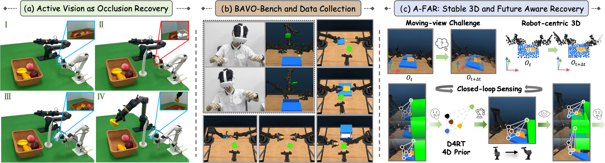
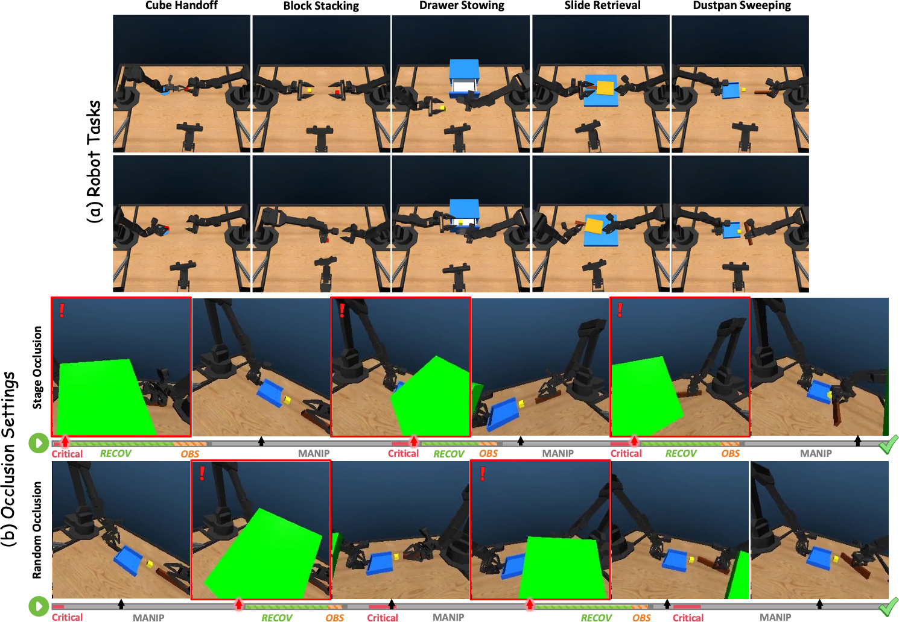

<h1 align="center">Recovering the View: Benchmarking Physical Active Vision for Occlusion Recovery in Robotic Manipulation</h1>

<p align="center">
  <a href="https://hcplab-sysu.github.io/BAVO-Bench/">
    
  </a>
  <a href="https://arxiv.org/abs/2609.37292">
    
  </a>
</p>

<p align="center">
  
</p>

**Overview of our motivation, benchmark, and approach.** **(a)** We study physical active vision as closed-loop recovery from external occlusion: using a single active camera as the sole visual sensor, the robot actively changes its viewpoint to recover task-relevant visibility and continue manipulation. **(b)** We introduce **BAVO-Bench**, a bimanual active-vision manipulation benchmark that systematically introduces controlled external occlusions to study viewpoint recovery, together with a VR teleoperation pipeline for collecting active-view demonstrations. **(c)** We present **A-FAR**, an active-vision policy that canonicalizes moving-view observations in robot-centric 3D and distills D4RT's 4D relational priors, enabling stable, future-aware control under active viewpoint changes.

<p align="center">
  
</p>

**BAVO-Bench overview.** **Top:** Five multi-stage bimanual manipulation tasks. **Bottom:** Representative rollouts under the two occlusion settings. Red-bordered frames mark occlusion events, and the timelines illustrate recovery and manipulation behaviors. Both settings occlude task-relevant targets; **Stage Occlusion** aligns interventions with predefined task transitions, whereas **Random-time Occlusion** samples intervention times independently of these transitions.

## Tasks and Datasets

Each task has three registered Gymnasium environments under the `bavo-bench/` namespace. Replace `<task>` with a task key from the table below:

- Clean: `bavo-bench/<task>-v1`
- Stage Occlusion: `bavo-bench/<task>-stage-occlusion-v1`
- Random-time Occlusion: `bavo-bench/<task>-random-occlusion-v1`

The linked Hugging Face datasets contain the Stage Occlusion demonstrations for the corresponding tasks (100 demonstrations per task).

| Task in the paper | Code task key (`<task>`) | Stage Occlusion demonstrations |
| --- | --- | --- |
| Cube Handoff | `cube-transfer-plate` | [Hugging Face dataset](https://huggingface.co/datasets/Keith-Luo/sim_cube_transfer_plate_stage_occlusion_100) |
| Block Stacking | `block-stack` | [Hugging Face dataset](https://huggingface.co/datasets/Keith-Luo/sim_block_stack_stage_occlusion_100) |
| Drawer Stowing | `drawer-storage` | [Hugging Face dataset](https://huggingface.co/datasets/Keith-Luo/sim_drawer_storage_stage_occlusion_100) |
| Slide Retrieval | `slide-pickup` | [Hugging Face dataset](https://huggingface.co/datasets/Keith-Luo/sim_slide_pickup_stage_occlusion_100) |
| Dustpan Sweeping | `dustpan-sweep` | [Hugging Face dataset](https://huggingface.co/datasets/Keith-Luo/sim_dustpan_sweep_stage_occlusion_100) |

## Installation and Quick Start

Python 3.10 is tested. Clone the repository and install the environments:

```bash
git clone https://github.com/HCPLab-SYSU/BAVO-Bench.git
cd BAVO-Bench
python -m pip install -e .
```

```python
import gymnasium as gym
import bavo_bench  # Registers the benchmark environments.

env = gym.make(
    "bavo-bench/cube-transfer-plate-stage-occlusion-v1",
    cameras={"zed_cam_right": (224, 224)},
)
observation, info = env.reset(seed=0)
print(observation["pixels"]["zed_cam_right"].shape)
env.close()
```

On a headless Linux machine, set `MUJOCO_GL=egl` and `PYOPENGL_PLATFORM=egl` before running the example. This repository provides the benchmark environments; policy training and rollout evaluation are handled by policy-specific code.

## Project Roadmap

- [x] Publish the paper and project page.
- [x] Release the BAVO-Bench Stage Occlusion demonstration datasets.
- [x] Release the BAVO-Bench code.

## Acknowledgments

We thank the authors of [gym_av_aloha](https://github.com/Soltanilara/gym_av_aloha) for releasing the AV-ALOHA simulation code and assets on which BAVO-Bench builds.

## Citation

```bibtex
@misc{luo2026recoveringviewbenchmarkingphysical,
  title={Recovering the View: Benchmarking Physical Active Vision for Occlusion Recovery in Robotic Manipulation},
  author={Kaijun Luo and Yudi Huang and Qijun Zhong and Xinshuai Song and Yang Liu and Liang Lin},
  year={2026},
  eprint={2609.37292},
  archivePrefix={arXiv},
  primaryClass={cs.RO},
  url={https://arxiv.org/abs/2609.37292},
}
```
